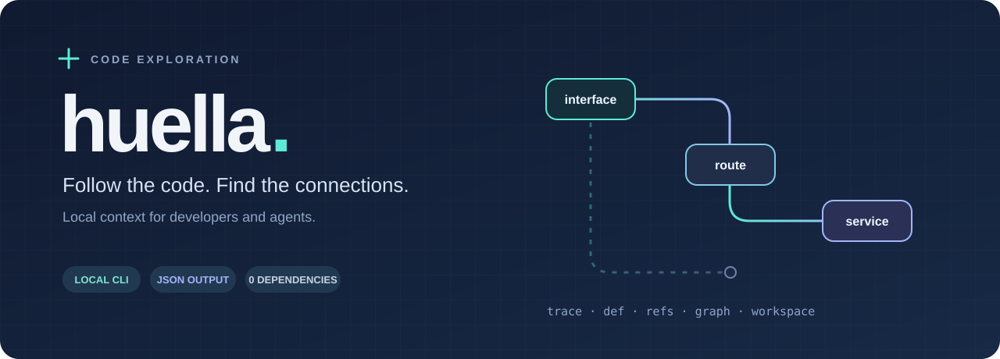
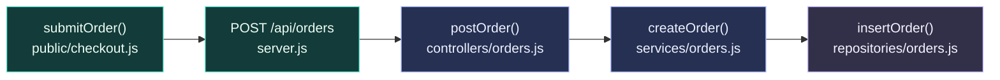
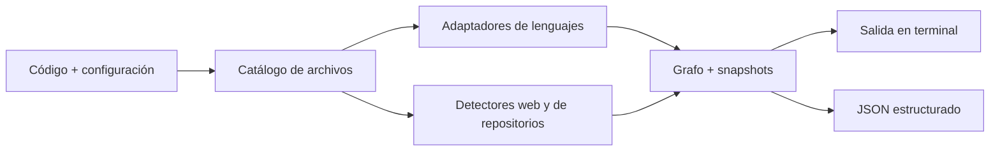

<div align="center">



**Un motor local para explorar código, pensado para desarrolladores y agentes.**

[](package.json)
[](package.json)
[](#alcance-y-límites)
[](#para-agentes)

[English](README.md) · **Español**

[Primeros pasos](#primeros-pasos) · [Demo](#seguí-un-pedido) · [Comandos](#comandos) · [Para agentes](#para-agentes) · [Cómo funciona](#cómo-funciona)

</div>

---

## De un nombre a las piezas que lo rodean

Una funcionalidad puede atravesar una petición del navegador, una ruta de API, un servicio y una capa de datos. Entenderla requiere conectar esas piezas.

**Huella sigue las pistas del código fuente.** Busca definiciones y referencias, extrae llamadas probables, detecta patrones de rutas y deduce relaciones dentro de un repositorio o entre varios. Podés consultar los resultados en la terminal o consumirlos como JSON.

El análisis corre localmente, sin una API key ni un LLM. Huella lee los archivos del proyecto y guarda su propia caché fuera del repositorio.

| Partís de… | Explorás… |
| --- | --- |
| El nombre de una función | Definiciones, referencias y llamadas probables |
| Una funcionalidad o término | Archivos relevantes, contexto y cadenas de llamadas inferidas |
| Un proyecto web | Señales de frameworks, interfaces, endpoints y patrones RPC compatibles |
| Una carpeta con repositorios | Conexiones probables entre servicios a partir de código, configuración y URLs |
| Un flujo con agentes | JSON con rutas, fragmentos de código, conteos y evidencias según la operación |

## Primeros pasos

Necesitás **Node.js 18 o superior**, según [`package.json`](package.json). Desde una terminal:

```bash
git clone https://github.com/lean4339/huella.git
cd huella
npm run demo
```

La demo incluida no necesita instalar dependencias. Para explorar tu propio proyecto, ejecutá desde la carpeta de Huella:

```bash
node src/cli/index.js createOrder /ruta/a/tu/repo
node src/cli/index.js def createOrder /ruta/a/tu/repo
node src/cli/index.js refs createOrder /ruta/a/tu/repo
```

Reemplazá `createOrder` por un símbolo o término de tu proyecto. Si una ruta contiene espacios, ponela entre comillas.

## Seguí un pedido

[`examples/order-flow`](examples/order-flow) incluye una petición de checkout, un registro de ruta con estilo Express, un controlador, un servicio y un repositorio simulado. Es una muestra de código para analizar: la demo no levanta un servidor ni se conecta a una base de datos.



El diagrama resume el código del ejemplo. La traza devuelve estas dos cadenas contiguas:

```text
controllers/orders.js  postOrder
  → services/orders.js  createOrder

services/orders.js  createOrder
  → repositories/orders.js  insertOrder
```

Probá las distintas vistas:

```bash
# Seguir el servicio y sus llamadas.
npm run demo

# Encontrar su definición y sus referencias.
node src/cli/index.js def createOrder examples/order-flow
node src/cli/index.js refs createOrder examples/order-flow

# Ver los conteos del grafo, incluido el endpoint y su enlace con la interfaz.
node src/agent/huella-tool.js graph examples/order-flow

# Consultar las relaciones descubiertas como JSON.
node src/agent/huella-tool.js trace createOrder examples/order-flow
```

El ejemplo permite encontrar la definición en `services/orders.js`, el endpoint `POST /api/orders` y el enlace desde `public/checkout.js` hacia ese endpoint.

## Comandos

Ejecutalos desde la carpeta de Huella. Si omitís la ruta, se usa el directorio de trabajo actual.

| Tarea | CLI para leer en terminal | Herramienta JSON |
| --- | --- | --- |
| Rastrear un término | `node src/cli/index.js <término> <repo>` | `node src/agent/huella-tool.js trace <término> <repo>` |
| Buscar definiciones | `node src/cli/index.js def <símbolo> <repo>` | `node src/agent/huella-tool.js def <símbolo> <repo>` |
| Buscar referencias | `node src/cli/index.js refs <símbolo> <repo>` | `node src/agent/huella-tool.js refs <símbolo> <repo>` |
| Explorar varios repos | `node src/cli/index.js workspace <carpeta>` | `node src/agent/huella-tool.js workspace <carpeta>` |
| Construir el grafo | — | `node src/agent/huella-tool.js graph <repo>` |

La CLI también acepta `--json`. La operación `graph` pertenece a la herramienta JSON; en la CLI humana, `graph` se interpreta como un término de búsqueda.

<details>
<summary><strong>Atajos con npm y comando local opcional</strong></summary>

```bash
npm run trace -- createOrder /ruta/al/repo
npm run --silent tool -- trace createOrder /ruta/al/repo
```

Usá `--silent` con npm cuando otro proceso espere JSON en stdout. Invocar directamente `node src/agent/huella-tool.js …` también evita el encabezado que imprime npm.

Para registrar el comando `huella` localmente:

```bash
npm link
huella createOrder /ruta/al/repo
huella def createOrder /ruta/al/repo
```

</details>

## Para agentes

La interfaz JSON expone cinco operaciones: `workspace`, `graph`, `trace`, `def` y `refs`. Un agente puede invocar el proceso y leer stdout.

Las respuestas exitosas tienen esta estructura; los campos de `result` dependen de la operación:

```json
{
  "ok": true,
  "operation": "def",
  "input": {
    "term": "createOrder",
    "projectDir": "/ruta/absoluta/al/repo"
  },
  "result": {}
}
```

En este ejemplo, `result` está abreviado. Una búsqueda de definiciones incluye `matchMode`, `counts`, `count` y `matches`, con archivos, rangos de líneas y fragmentos de código. Los errores devuelven `{"ok": false, "error": {"message": "…"}}` y un código de salida distinto de cero.

La integración actual es un proceso con salida JSON. Un servidor MCP o un adaptador para un editor serían integraciones adicionales.

## Cómo funciona



| Capa | Responsabilidad |
| --- | --- |
| [`scanners`](src/scanners) | Descubrir archivos relevantes y omitir carpetas comunes de dependencias y compilación |
| [`languages`](src/languages) | Extraer símbolos, imports y llamadas probables mediante adaptadores |
| [`frameworks`](src/frameworks), [`ui`](src/ui), [`endpoints`](src/endpoints), [`rpc`](src/rpc) | Reconocer convenciones web y conectar patrones compatibles |
| [`workspaces`](src/workspaces) | Descubrir repositorios e inferir conexiones entre servicios |
| [`graph`](src/graph) | Guardar el grafo y resúmenes de snapshots por término |
| [`core`](src/core), [`output`](src/output) | Consultar los datos y presentar resultados |

### Lenguajes y señales de frameworks

Hay adaptadores para **JavaScript / TypeScript, Python, C#, Go, Java y PHP**. La profundidad de extracción depende del lenguaje y de la sintaxis.

Los detectores buscan señales de **Next.js, Express, NestJS, Qwik, ASP.NET Core, Spring Boot, FastAPI, Django, Flask, Laravel, Symfony, Gin, Fiber y Echo**. Detectar un framework no implica cubrir todas sus rutas o su semántica.

<details>
<summary><strong>Orden de los frameworks detectados</strong></summary>

Los candidatos se ordenan con `rankScore = score + preferenceBoost`. El puntaje proviene de las señales encontradas; el ajuste expresa una preferencia, no un porcentaje de confianza.

Los valores predeterminados están en [`src/frameworks/preferences.js`](src/frameworks/preferences.js). Podés ajustar cada preferencia mediante una variable con JSON:

```bash
export HUELLA_FRAMEWORK_PREFERENCES='{"fastapi":25,"express":12,"qwik":15}'
node src/agent/huella-tool.js graph /ruta/al/repo
```

</details>

## Alcance y límites

Huella es una **herramienta experimental de exploración heurística**. Las relaciones son pistas para revisar en el código: pueden existir falsos positivos y coincidencias ausentes. La extracción usa patrones en lugar de parsers completos o trazas de ejecución.

- Los recorridos tienen límites: 5.000 archivos catalogados por repositorio; para workspaces, hasta 30 repositorios, tres niveles de directorios y 3.000 archivos por repositorio de forma predeterminada.
- Se omiten `.git`, `node_modules`, `dist`, `build` y otras carpetas comunes. El scanner usa reglas propias; no interpreta `.gitignore`.
- Los grafos y snapshots se guardan en `~/.cache/huella/`. No se reescribe el código fuente. Los deltas resumen conteos; no constituyen un diff semántico completo.
- Los resultados y la caché pueden incluir líneas de código y valores de configuración. Revisá su contenido antes de publicarlo o enviarlo a un servicio externo.

## Próximos pasos y contribuciones

Sirven especialmente los ejemplos mínimos que reproduzcan relaciones incorrectas o ausentes, las mejoras de extracción y los adaptadores para agentes. Incluí el comando utilizado y la relación que esperabas encontrar.

Las consultas de impacto más amplias, los diffs estructurales y las integraciones son líneas de desarrollo. [`PLAN.md`](PLAN.md) conserva el plan de diseño original; los comandos de este README describen la interfaz actual.

---

Creado por **[Leandro Ayala](https://github.com/lean4339)** · [LinkedIn](https://www.linkedin.com/in/leandro-sebastian-ayala-/) · [Reportar un problema](https://github.com/lean4339/huella/issues)

*Seguí las huellas que deja el código.*
