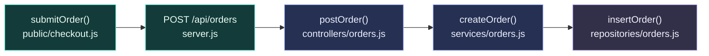
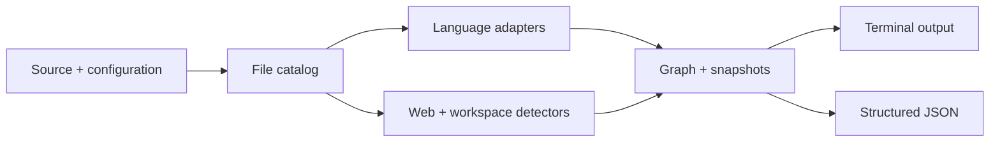

<div align="center">


**A local code exploration engine for developers and agents.**

[](package.json)
[](package.json)
[](#scope-and-limits)
[](#for-agents)

**English** · [Español](README.es.md)

[Quick start](#quick-start) · [Demo](#follow-an-order) · [Commands](#commands) · [For agents](#for-agents) · [How it works](#how-it-works)

</div>

---

## From a symbol to its surroundings

A feature can span a browser request, an API route, a service and a data layer. Understanding it means connecting those pieces.

**Huella follows the clues in your source code.** It finds definitions and references, extracts probable calls, detects supported route patterns and infers relationships within a repository or across a workspace. Results are available in the terminal and as structured JSON.

The analysis runs locally, without an API key or an LLM. Huella reads project files and writes its own cache outside the repository.

| Start with… | Explore… |
| --- | --- |
| A function name | Definitions, matching references and probable callers/callees |
| A feature or term | Relevant files, surrounding code and inferred call chains |
| A web repository | Framework signals, UI surfaces, endpoints and supported RPC patterns |
| A folder of repositories | Inferred service connections from code, configuration and URLs |
| An agent workflow | JSON results with paths, snippets, counts and operation-specific evidence |

## Quick start

Requires **Node.js 18 or newer**, as declared in [`package.json`](package.json). Run these commands in a terminal:

```bash
git clone https://github.com/lean4339/huella.git
cd huella
npm run demo
```

The included demo needs no dependency installation. To explore your own repository, run from the Huella directory:

```bash
node src/cli/index.js createOrder /path/to/your/repo
node src/cli/index.js def createOrder /path/to/your/repo
node src/cli/index.js refs createOrder /path/to/your/repo
```

Replace `createOrder` with a symbol or term from your project. Quote paths containing spaces.

## Follow an order

The included [`examples/order-flow`](examples/order-flow) is a small source fixture: a checkout request, an Express-style route registration, a controller, a service and a repository stub. Huella reads these files; the demo does not start a server or connect to a database.



The diagram summarizes the fixture's source. The trace reports these two adjacent call chains:

```text
controllers/orders.js  postOrder
  → services/orders.js  createOrder

services/orders.js  createOrder
  → repositories/orders.js  insertOrder
```

Try each view:

```bash
# Trace the service and its surrounding calls.
npm run demo

# Locate its definition and references.
node src/cli/index.js def createOrder examples/order-flow
node src/cli/index.js refs createOrder examples/order-flow

# Inspect the graph counts, including the endpoint and UI-to-endpoint link.
node src/agent/huella-tool.js graph examples/order-flow

# Inspect the discovered relationships as JSON.
node src/agent/huella-tool.js trace createOrder examples/order-flow
```

The fixture produces a definition in `services/orders.js`, an endpoint for `POST /api/orders` and a link from `public/checkout.js` to that endpoint.

## Commands

Run these from the Huella directory. Paths default to the current working directory when omitted.

| Task | Human-readable CLI | JSON tool |
| --- | --- | --- |
| Trace a term | `node src/cli/index.js <term> <repo>` | `node src/agent/huella-tool.js trace <term> <repo>` |
| Find definitions | `node src/cli/index.js def <symbol> <repo>` | `node src/agent/huella-tool.js def <symbol> <repo>` |
| Find references | `node src/cli/index.js refs <symbol> <repo>` | `node src/agent/huella-tool.js refs <symbol> <repo>` |
| Explore a workspace | `node src/cli/index.js workspace <folder>` | `node src/agent/huella-tool.js workspace <folder>` |
| Build a repository graph | — | `node src/agent/huella-tool.js graph <repo>` |

The human CLI also accepts `--json`. The `graph` operation belongs to the JSON tool; passing `graph` to the human CLI searches for that term.

<details>
<summary><strong>npm shortcuts and an optional local command</strong></summary>

```bash
npm run trace -- createOrder /path/to/repo
npm run --silent tool -- trace createOrder /path/to/repo
```

Use `--silent` with npm when another process expects JSON on stdout. Direct `node src/agent/huella-tool.js …` calls also produce JSON without npm's script banner.

To register the `huella` command locally:

```bash
npm link
huella createOrder /path/to/repo
huella def createOrder /path/to/repo
```

</details>

## For agents

The JSON wrapper exposes five operations: `workspace`, `graph`, `trace`, `def` and `refs`. An agent can invoke the process and parse stdout.

Successful responses use this envelope; the `result` fields depend on the operation:

```json
{
  "ok": true,
  "operation": "def",
  "input": {
    "term": "createOrder",
    "projectDir": "/absolute/path/to/repo"
  },
  "result": {}
}
```

Here, `result` is intentionally abbreviated. A definition result includes `matchMode`, `counts`, `count` and `matches`, with file paths, line ranges and snippets. Errors use `{"ok": false, "error": {"message": "…"}}` and a nonzero exit code.

This is a process-based JSON interface. An MCP server or editor adapter would be a separate integration.

## How it works



| Layer | Responsibility |
| --- | --- |
| [`scanners`](src/scanners) | Discover relevant files and skip common dependency/build directories |
| [`languages`](src/languages) | Extract symbols, imports and probable calls through language adapters |
| [`frameworks`](src/frameworks), [`ui`](src/ui), [`endpoints`](src/endpoints), [`rpc`](src/rpc) | Detect web conventions and connect supported patterns |
| [`workspaces`](src/workspaces) | Discover repositories and infer connections between services |
| [`graph`](src/graph) | Persist graph data and per-term snapshot summaries |
| [`core`](src/core), [`output`](src/output) | Query the extracted data and format results |

### Languages and framework signals

Language adapters cover **JavaScript / TypeScript, Python, C#, Go, Java and PHP**. Extraction depth varies by language and syntax.

Framework detectors look for signals associated with **Next.js, Express, NestJS, Qwik, ASP.NET Core, Spring Boot, FastAPI, Django, Flask, Laravel, Symfony, Gin, Fiber and Echo**. Detecting a framework does not imply complete route or semantic support for that framework.

<details>
<summary><strong>Framework ranking</strong></summary>

Detected candidates are ordered by `rankScore = score + preferenceBoost`. The score comes from matching signals; the boost is a preference, not a confidence percentage.

Defaults live in [`src/frameworks/preferences.js`](src/frameworks/preferences.js). Override individual boosts with a JSON environment variable:

```bash
export HUELLA_FRAMEWORK_PREFERENCES='{"fastapi":25,"express":12,"qwik":15}'
node src/agent/huella-tool.js graph /path/to/repo
```

</details>

## Scope and limits

Huella is an **experimental, heuristic exploration tool**. Its relationships are clues to inspect in the source, with possible false positives and missing matches. Extraction uses patterns rather than complete language parsers or runtime tracing.

- Scans are bounded: a repository scan defaults to 5,000 cataloged files; workspace discovery defaults to 30 repositories, up to three directory levels, with 3,000 cataloged files per repository.
- `.git`, `node_modules`, `dist`, `build` and other common generated directories are skipped. The scanner uses its own rules; it does not interpret `.gitignore`.
- Graphs and snapshots are written under `~/.cache/huella/`. Project source files are not rewritten. Snapshot deltas summarize counts, rather than providing a complete semantic diff.
- Matching source lines and configuration values can appear in results and cache files. Review those contents before sharing an output or passing it to an external service.

## Help shape the next steps

Useful contributions include small reproduction fixtures, reports of missed or incorrect relationships, more precise extractors and adapters for agent workflows. Include the command you ran and the relationship you expected to find.

Broader impact queries, richer structural diffs and integrations are development directions. [`PLAN.md`](PLAN.md) records the original design plan; the commands above describe the current interface.

---

Built by **[Leandro Ayala](https://github.com/lean4339)** · [LinkedIn](https://www.linkedin.com/in/leandro-sebastian-ayala-/) · [Report an issue](https://github.com/lean4339/huella/issues)

*Huella means “trace” or “footprint” in Spanish. Follow what the code leaves behind.*
